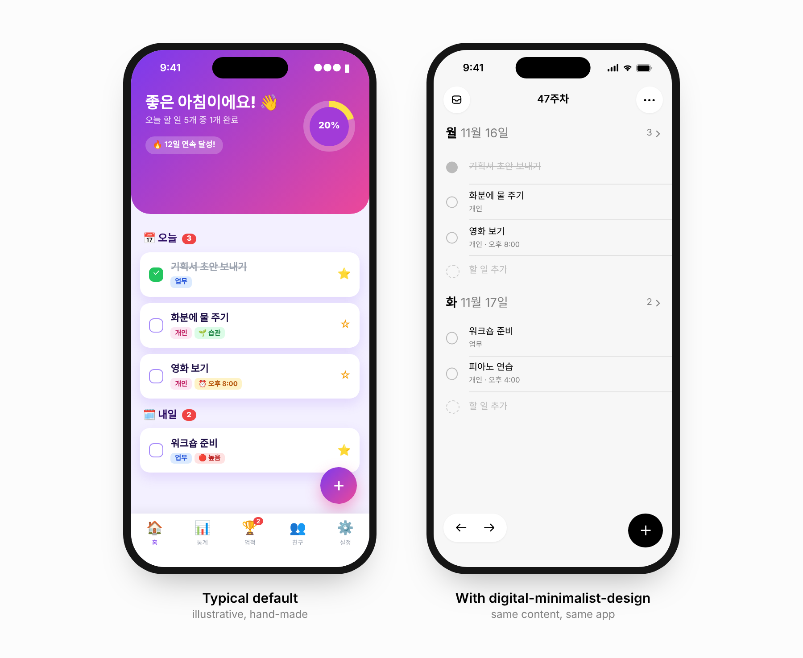
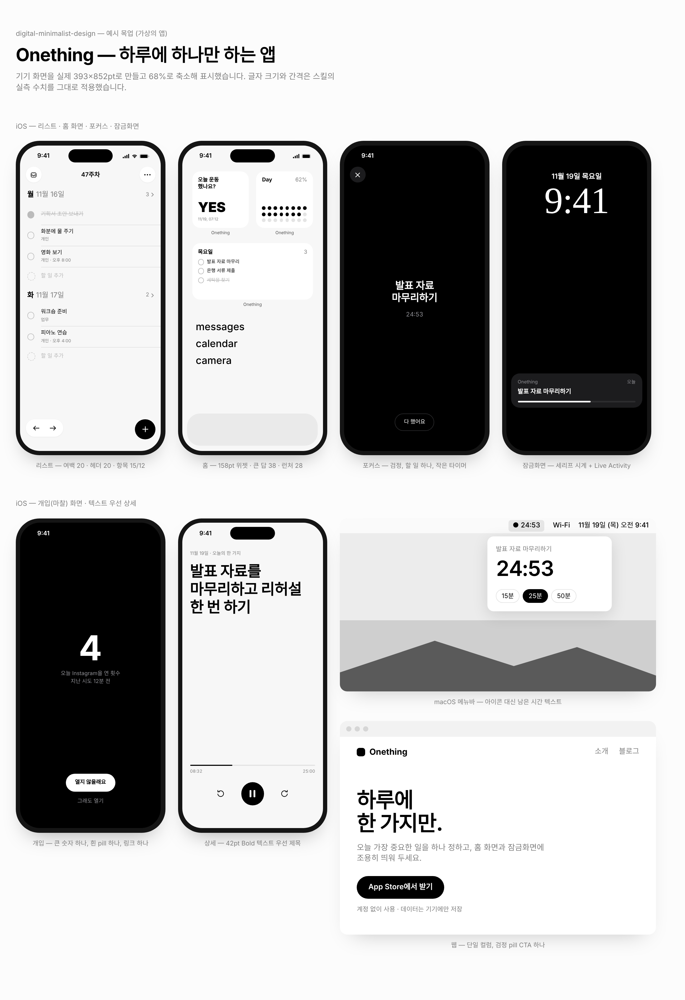

# digital-minimalist-design

**조용한 소프트웨어를 위한 에이전트 스킬.** Claude(그리고 스킬을 지원하는 다른 에이전트)가 한 가지 일만 하고, 주의를 빼앗지 않고, 앱을 열지 않아도 쓸 수 있는 앱을 디자인하도록 가르칩니다. 흑백, 텍스트 우선, 위젯 우선.

[English README](README.md)



<sub>왼쪽은 흔한 패턴을 보여주려고 직접 만든 예시이며, 실제 모델 출력이 아닙니다. 오른쪽은 같은 내용에 이 스킬을 적용한 화면입니다.</sub>

## 다른 미니멀 스킬과 무엇이 다른가

기존 미니멀 UI 스킬은 대부분 **미학**(에디토리얼 웹 레이아웃, 벤토 그리드, 차분한 색)을 다룹니다. 이 스킬은 **주의(attention)** 를 다룹니다.

- **스타일이 아니라 제품 원칙**: 한 가지 일만 한다. 앱을 열지 않아도 쓸모 있게. 중독성 행동 앞에는 의도적 마찰을. 배지·스트릭·피드 금지.
- **추측이 아니라 실측**: 글자 크기, 간격, 회색 값을 실제 레퍼런스 앱 화면에서 픽셀 단위로 측정했습니다([`measurements.md`](skills/digital-minimalist-design/references/measurements.md)).
- **화면 밖의 표면까지**: 위젯, 잠금화면, Live Activity, Dynamic Island, macOS 메뉴바를 주 무대로 다룹니다.
- **화면만이 아니라 동작까지**: 모션, 제스처, 햅틱, 로딩·오류·오프라인 상태, 알림, 접근성을 Calm Technology, Apple HIG, Material 3에 근거해 정리했습니다.
- **멀티 플랫폼**: iOS, Android, 웹, macOS, e-ink/저자극 모드, 그리고 한국어 타이포그래피 주의점.

## 구성

```
skills/digital-minimalist-design/
├── SKILL.md                    # 스킬 본문 (영어, 기준 문서)
└── references/
    ├── measurements.md         # 측정 방법, 원본 수치, 오차
    ├── sources.md              # 동작 규칙의 근거 자료
    └── tokens.css              # 바로 쓰는 CSS 토큰 (라이트/다크)
docs/
├── SKILL.ko.md                 # 한국어판
└── images/
examples/
└── onething-mockup.html        # 스킬로 만든 예시 목업
```

## 설치

**Claude Code 또는 `skills` CLI를 쓰는 에이전트**

```bash
npx skills add tingoofriend/digital-minimalist-design
```

직접 복사해도 됩니다.

```bash
cp -r skills/digital-minimalist-design ~/.claude/skills/
```

**Claude 앱 (claude.ai / 데스크톱)**
`skills/digital-minimalist-design` 폴더를 zip으로 압축한 뒤, Claude 설정의 Skills 메뉴에서 업로드하세요.

**한국어로 쓰고 싶다면** `docs/SKILL.ko.md` 맨 위에 영어판과 같은 frontmatter를 붙여 `SKILL.md`로 저장하면 됩니다.

## 사용 예

> digital-minimalist-design 스킬로 습관 트래커를 디자인해줘. 위젯부터 시작해.

> 내 SwiftUI 앱의 설정 화면을 디지털 미니멀리스트 스타일로 만들어줘.

## 예시



[`examples/onething-mockup.html`](examples/onething-mockup.html)을 브라우저로 열어 보세요. 휴대폰 화면은 실제 393×852pt로 만들고 68%로 축소해 표시했습니다.

## 한계

- 수치는 홍보용 스크린샷에서 측정해서, 글자는 약 ±1pt, 간격은 약 ±2pt의 오차가 있습니다. 공식 스펙이 아니라 참고값입니다.
- iPhone을 기준으로 맞췄고, Android·웹 내용은 이를 옮겨 온 것입니다.
- 하나의 뚜렷한 취향입니다. 브랜드 컬러나 밀도 높은 데이터 화면이 필요하면 규칙집이 아니라 출발점으로 쓰세요.

## 출처와 표기

- 이 스타일은 [Digital Minimalist 블로그](https://www.digitalminimalist.com/blog)의 앱 큐레이션을 분석해 정리했습니다. 이 프로젝트는 해당 블로그와 **제휴 관계가 없습니다**.
- `SKILL.md`의 앱 이름은 스타일 참고용으로만 인용했으며, 모든 상표는 각 소유자에게 있습니다. 이 저장소에는 제3자 스크린샷이 없고, 모든 이미지는 이 프로젝트를 위해 직접 만들었습니다.

## 기여

이슈와 PR 환영합니다. 특히 아래 기여가 반갑습니다.

- 더 많은 레퍼런스 앱의 실측값 (측정 방법을 함께 적어 주세요)
- Android / Jetpack Compose, 웹 컴포넌트 예시
- 번역

## 라이선스

[MIT](LICENSE)
