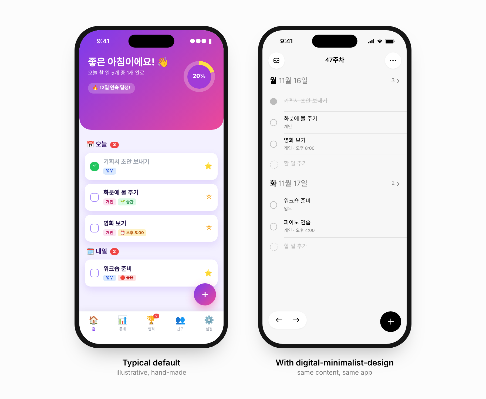
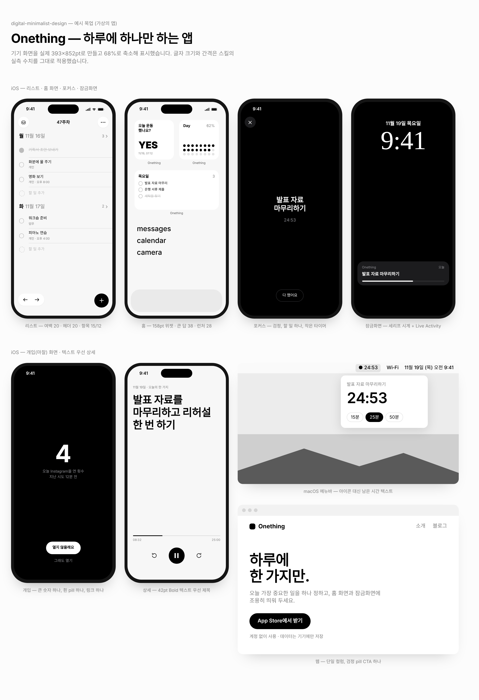

# digital-minimalist-design

**An Agent Skill for calm software.** It teaches Claude (and other skill-compatible agents) to design apps that do one thing, stay out of the way, and are often used without being opened at all: monochrome, text-first, widget-first.

[한국어 README](README.ko.md)



<sub>Left: an illustrative "typical default" I made by hand to show common patterns. It is not real model output. Right: the same content after applying this skill.</sub>

## Why another minimalist skill?

Most minimalist UI skills are about **aesthetics**: editorial web layouts, bento grids, muted palettes. This one is about **attention**:

- **Product principles, not just style.** Do one thing. Be useful without opening the app. Add deliberate friction before compulsive actions. No badges, streaks, or feeds.
- **Measured, not guessed.** Type sizes, spacing, and grays were pixel-measured from real reference apps (see [`measurements.md`](skills/digital-minimalist-design/references/measurements.md)).
- **Surfaces beyond the screen.** Widgets, Lock Screen, Live Activities, the Dynamic Island, and the macOS menu bar are first-class.
- **Behavior, not only pixels.** Motion, gestures, haptics, loading/error/offline states, notifications, and accessibility, grounded in Calm Technology, Apple HIG, and Material 3.
- **Multi-platform.** iOS, Android, web, macOS, and e-ink / low-stimulus modes, plus CJK typography notes.

## What's inside

```
skills/digital-minimalist-design/
├── SKILL.md                    # the skill (English, canonical)
└── references/
    ├── measurements.md         # how values were measured, raw numbers, error margins
    ├── sources.md              # references behind the behavior rules
    └── tokens.css              # drop-in CSS tokens (light + dark)
docs/
├── SKILL.ko.md                 # Korean version
└── images/                     # README images
examples/
└── onething-mockup.html        # example mockup built with the skill
```

Highlights from `SKILL.md`:

| | |
|---|---|
| Colors | bg `#F7F7F7` / `#000`, text-2 `#808080`, text-3 `#BBBBBB`, divider `#E2E2E2`, no accent |
| Type | header 20 pt Semibold · row 15 pt · meta 12 pt · content title 40–44 pt Bold |
| Layout | 20 pt margins · 20 pt round checkboxes · 56/59 pt rows · 44 pt circular buttons |
| Patterns | text launcher, big-answer widget, dot-grid progress, single note, focus mode, intervention screen, text-first player, menu-bar popover |
| Behavior | 100–250 ms motion, no bounce · swipe to complete, undo over confirm · haptics only on discrete events · silent saving · opt-in, user-scheduled notifications only · WCAG-checked grays |

## Install

**Claude Code / any agent using the `skills` CLI**

```bash
npx skills add tingoofriend/digital-minimalist-design
```

Or copy the folder manually:

```bash
cp -r skills/digital-minimalist-design ~/.claude/skills/
```

**Claude apps (claude.ai / desktop)**
Zip the `skills/digital-minimalist-design` folder and upload it from the Skills section of Claude's settings.

## Usage

The skill loads automatically when you ask for UI work. You can also name it:

> Design a habit tracker using the digital-minimalist-design skill. Start with the widget.

> Build the settings screen for my SwiftUI app in the digital minimalist style.

## Example



Open [`examples/onething-mockup.html`](examples/onething-mockup.html) in a browser. The phone screens are built at a real 393×852 pt and shown at 68% scale.

## Limitations

- Values were measured from promotional screenshots, so they carry about ±1 pt error for type and ±2 pt for spacing. They are references, not specs.
- The system is tuned for iPhone first; Android and web sections are adaptations.
- One opinionated style. If your product needs a brand color or dense data views, use this skill as a starting point rather than a rulebook.

## Credits and attribution

- The style was distilled from the app curation published on the [Digital Minimalist blog](https://www.digitalminimalist.com/blog). This project is **not affiliated** with that blog.
- App names in `SKILL.md` are cited only as style references. All trademarks belong to their owners. No third-party screenshots are included in this repository; all images were made for this project.

## Contributing

Issues and PRs are welcome, especially:

- measurements from more reference apps (please include your method)
- Android / Jetpack Compose and web component examples
- translations

## License

[MIT](LICENSE)
